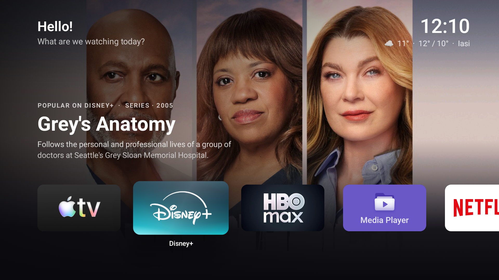

# Parallax

A free, open-source home screen for Android TV and Google TV, inspired by the look and feel of tvOS:
springy focus, tilting icons with a light sheen, a Top Shelf that follows the focused app, and frosted glass.



> Parallax is an independent project. It is not affiliated with or endorsed by Apple, and ships no Apple assets.

## Status

Early work in progress. Today it has:

- A single, sideways-scrolling row of apps with tvOS-style focus (lift, shadow, tilt, sheen)
- A Top Shelf that features popular shows and films from the focused streaming service (via TMDB)
- Rearranging apps: hold OK on an app, move it with the arrows, press OK to drop
- A greeting, a clock and today's weather (Open-Meteo)
- A Settings tile (Google TV hides Settings from app lists)

Planned: folders, Control Center, screensaver, layered icon packs, a settings screen.

### Setting the greeting name

```bash
adb shell am start -n com.parallax.launcher/.MainActivity --es name "Your name"
```

## Install

1. Grab `app-debug.apk` from the latest [build](../../actions) or release.
2. Enable developer options on the TV (Settings → System → About → press *Android TV OS build* 7 times),
   then turn on *USB debugging*.
3. From a computer on the same network:

   ```bash
   adb connect <tv-ip>:5555
   adb install app-debug.apk
   ```

### Making it the default home screen

Classic Android TV asks which launcher to use when you press Home. Google TV doesn't, so the stock launcher has
to be disabled:

```bash
adb shell pm disable-user --user 0 com.google.android.apps.tv.launcherx
adb shell pm disable-user --user 0 com.google.android.tungsten.setupwraith
```

The second command disables Google TV's recovery screen, which otherwise takes over the Home button with a black
screen. It is only used during first-time setup. To undo both:

```bash
adb shell pm enable com.google.android.apps.tv.launcherx
adb shell pm enable com.google.android.tungsten.setupwraith
```

## Building

Requires JDK 17+ and the Android SDK.

### Top Shelf titles (optional)

When a streaming app is focused, the Top Shelf can feature popular titles from that service in your region,
using [TMDB](https://www.themoviedb.org/). Create a free account, open *Settings → API*, and copy the
**API Read Access Token** into `local.properties` (never commit it):

```properties
tmdb.token=eyJhbGciOi...
```

Without a token the Top Shelf shows a blurred version of the app's banner instead.

This product uses the TMDB API but is not endorsed or certified by TMDB.

```bash
./gradlew assembleDebug
```

## License

[GPL-3.0](LICENSE)
